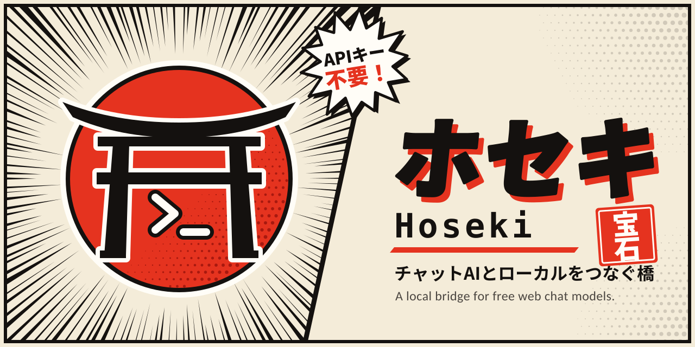

<div align="center">

<h2><b>Hoseki: Give Free Web Chat Models Hands on Your Local Machine</b></h2>

</div>

<div align="center">

[](https://github.com/mufasa-noir/hoseki/blob/main/LICENSE)


</div>

<div align="center">

[English](README.md) | [日本語](README_ja.md)

</div>

<div align="center">
  
</div>

> Hoseki is a **local bridge** that lets free web chat UIs (Kimi, GLM, DeepSeek, and more) read, search, and edit files in your project folder, and run commands with your approval. **No LLM API keys, no paid plans.**

## 📜 Introduction

Top-tier models are often free in a browser tab but locked behind paid API keys the moment you want them to touch your files. **Hoseki** closes that gap. It sits between a chat page and your filesystem so the model you're already talking to can help with software development and security code review.

It is made of three small pieces:

1. A **local daemon** that exposes filesystem and command tools over HTTP on `127.0.0.1`, with a path jail, token auth, and a human approval gate.
2. A **browser extension** (Manifest V3 for Chrome, with a separate Firefox build) that watches the chat page, detects tool-call blocks in the model's reply, sends them to the daemon, and drops the results back into the chat input.
3. A **prompt preamble** you paste at the start of a chat that teaches the model the tool-call protocol.

> **Status:** All six roadmap phases are implemented (see the [Roadmap](#️-roadmap)). Hoseki is still early software, and site adapters in particular are best-effort: chat UIs change without notice, so expect to refresh selectors now and then (see [Finding and Configuring Selectors](#finding-and-configuring-selectors)).

## 🏗️ Architecture

```
┌──────────────────────────────┐
│         Chat web UI          │
│  (Kimi, z.ai, DeepSeek, …)   │
└──────────────────────────────┘
                ▲
                │ DOM adapters
                ▼
┌──────────────────────────────┐
│      Browser extension       │
│    MV3, background worker    │
└──────────────────────────────┘
                │ POST /v1/call
                │ HTTP 127.0.0.1
                │ Authorization: Bearer …
                ▼
┌──────────────────────────────┐
│        Hoseki daemon         │
│      FastAPI + uvicorn       │
│                              │
│  auth.py      Origin/Host    │
│  jail.py      path jail      │
│  secrets.py   deny-list      │
│  approval.py  terminal       │
│  tools/       registry       │
│  audit.py     JSONL          │
└──────────────────────────────┘
                │ reused by
                ▼
┌──────────────────────────────┐
│      hoseki mcp (stdio)      │
│      JSON-RPC, same ctx      │
└──────────────────────────────┘
```

| Module        | Role                                                                    |
| ------------- | ----------------------------------------------------------------------- |
| `auth.py`     | Bearer token check plus `Origin`/`Host` validation (DNS-rebinding defense) |
| `jail.py`     | Resolves every path and enforces containment inside the workspace root  |
| `secrets.py`  | Deny-list for sensitive files (`.env`, keys, and similar)               |
| `approval.py` | Terminal prompt that shows the diff or command and waits for your y/n   |
| `tools/`      | Tool registry (`read_file`, `grep`, `apply_patch`, `run_cmd`, ...)      |
| `audit.py`    | Append-only JSONL log of every call and approval decision               |

The extension is the only thing that talks to the daemon, over `POST /v1/call` with a bearer token. `hoseki mcp` is a stdio (JSON-RPC) adapter that reuses the same tool context, so MCP-capable clients get the same jail, approval gate, and audit log as the browser path.

## 🧰 Toolset

All paths are relative to the configured workspace root.

| Tool          | What it does                                                          | Approval  |
| ------------- | --------------------------------------------------------------------- | --------- |
| `tree`        | Recursive directory tree with a count summary. Skips `.gitignore`'d paths and common build/cache dirs (`node_modules`, `.next`, `__pycache__`, `target`, `dist`, `build`, `.venv`, …). | automatic |
| `list_dir`    | Shallow directory listing. Symlinks shown with their target, never followed. | automatic |
| `read_file`   | Read numbered lines with a range, truncation flag, and total line count | automatic |
| `grep`        | Regex search (uses `ripgrep` if installed, Python fallback otherwise). Respects `.gitignore` and the same skip list as `tree`. | automatic |
| `find_files`  | Glob for files. Same ignore rules as `grep`.                          | automatic |
| `write_file`  | Write or append to a file (`mode="w"` overwrites, `mode="a"` appends). Shows a diff first. | **you approve** |
| `apply_patch` | Apply a unified diff, fails cleanly if it doesn't apply               | **you approve** |
| `run_cmd`     | Run a command (allowlist and/or Docker sandbox)                       | **you approve** |

Reads are auto-approved. Writes and commands **never** are.

The read tools skip paths matched by `.gitignore` at the workspace root,
plus a built-in list of caches and build outputs, so the model doesn't
waste context on `node_modules` or `__pycache__`. Add your own exclusions
under `[ignore]` in `config.toml` (`extra_dirs` and `extra_files`). Pass
`"respect_ignore": false` on an individual call to opt out.

## 🔒 Security Model

Hoseki is meant to be pointed at **untrusted code**, so it assumes file contents are hostile and may contain prompt injection.

- **Path jail**: every path is resolved and verified to sit inside the workspace root. `..` escapes, absolute paths outside the root, and symlinks that resolve outside it are rejected.
- **Localhost only**: the daemon binds to `127.0.0.1`, requires a random bearer token (stored with `0600` permissions), and validates `Origin`/`Host` headers to defend against DNS rebinding.
- **Human approval gate**: writes and commands pause for a local y/n prompt showing the full diff or command. Nothing in the model's output or a file's contents can pre-approve or bypass it.
- **Command sandbox**: `run_cmd` is deny-by-default. It can run inside a Docker container with no network and the workspace mounted read-only. If Docker is unavailable, Hoseki refuses to run commands unless you explicitly set `unsafe_host_exec = true`.
- **Secrets denylist**: `.env`, `*.pem`, `id_rsa*`, and similar files are unreadable by default.
- **Limits**: max read size, max output size, max calls per minute, and max command runtime are all configurable.
- **Audit log**: every tool call, its arguments, the approval decision, and a result summary are appended to a local JSONL log.
- **Untrusted-data framing**: file contents in tool results are wrapped in delimiters, and the preamble tells the model that anything inside them is data, never instructions.

> **Honest caveat:** delimiters and instructions reduce prompt-injection risk, they do not eliminate it. The approval gate and the no-network sandbox are what actually limit the damage.

## 🚀 Getting Started

> **Want the slow, safe version?** [docs/RUNNING.md](docs/RUNNING.md) walks through every step with a checkpoint after each one. What follows is the short version.

### Prerequisites

- Python 3.11 or newer (`python3 --version`) and `git`
- (Optional) [Docker](https://www.docker.com/) for the command sandbox, and [`ripgrep`](https://github.com/BurntSushi/ripgrep) for faster `grep`
- `curl` and `jq` if you want to run the verification commands below

### Step 1: Install

```
git clone https://github.com/mufasa-noir/hoseki.git
cd hoseki
python3 -m venv .venv
source .venv/bin/activate          # Windows: .venv\Scripts\activate
pip install -e '.[dev]'
hoseki --version                   # should print: hoseki 0.2.2
```

### Step 2: Configure

```
cp config.example.toml config.toml
```

Then set the workspace root, the one setting you need to start:

```toml
[workspace]
root = "/absolute/path/to/a/throwaway/folder"
```

> Start with a throwaway folder (a directory with a file or two), **not** real code. Every other setting (limits, command allow-list, secrets deny-list) is documented in `config.example.toml`.

### Step 3: Start the Daemon

```
hoseki serve --config ./config.toml
```

You should see a line like this, and the process should keep running:

```
hoseki 0.2.2 listening on http://127.0.0.1:8765  workspace=/abs/path/to/folder
```

Leave this terminal open: **approval prompts appear here.** Your auth token lives at `~/.hoseki/token`.

### Step 4: Verify the Daemon

In a second terminal:

```
export TOKEN=$(cat ~/.hoseki/token)
export HOSEKI=http://127.0.0.1:8765

curl -s $HOSEKI/v1/health | jq

# the path jail check: this one MUST fail
curl -s -H "Authorization: Bearer $TOKEN" \
     -H "Content-Type: application/json" \
     -d '{"name":"read_file","args":{"path":"../../etc/passwd"}}' \
     $HOSEKI/v1/call | jq
```

The first call prints `{"ok": true, "service": "hoseki", ...}`. The second must print `"ok": false` with an error saying the path resolves outside the workspace root. **If it prints file contents instead, stop: the jail is broken.**

### Step 5: Load the Extension

There's one build per browser: `extension/chrome/` for Chrome, Edge, Brave, and other Chromium browsers, and `extension/firefox/` for Firefox.

**Chrome and other Chromium browsers**

1. Open `chrome://extensions` (or your browser's equivalent) and enable **Developer mode**.
2. Click **Load unpacked** and select the `extension/chrome/` folder.

**Firefox**

1. Open `about:debugging#/runtime/this-firefox`.
2. Click **Load Temporary Add-on…** and select `extension/firefox/manifest.json`. Temporary add-ons are removed when Firefox closes, so repeat this next session.

**Then, in either browser**

1. Open the Hoseki popup, set **Daemon URL** to `http://127.0.0.1:8765`, paste the contents of `~/.hoseki/token` into **Bearer token**, and click **Save**.
2. Click **Check health**. It must print `{"ok": true, ...}`.

> If Hoseki doesn't run on a chat site in Firefox, open `about:addons` → Hoseki → **Permissions** and make sure site access is granted.

### Step 6: Open a Chat and Paste the Preamble

1. Open a supported chat: [chat.z.ai](https://chat.z.ai) (GLM), [kimi.com](https://kimi.com), or [chat.deepseek.com](https://chat.deepseek.com) (DeepSeek). In DevTools (F12) → Console you should see `[Hoseki] content script active for ...`.
2. In the popup, click **Copy preamble**, paste it as your **first message**, and send it.

### Step 7: Ask Away

Try something small first:

> List the files in my workspace and read the first 20 lines of the only file you find.

The model emits a `tool` block, a small overlay appears at the bottom right of the chat showing a green check, and a `tool_result` block lands in the chat input. **You press send yourself.** Nothing is sent automatically.

Writes (and commands, if you enable them) pause the daemon and wait for your `y`/`N` in the daemon terminal.

> Once everything works on the throwaway folder, daily use is just `hoseki serve`, a fresh chat with the preamble, and watching the daemon terminal for approvals. See [docs/RUNNING.md](docs/RUNNING.md) for the write-approval walkthrough, enabling commands, and troubleshooting.

## 🔌 Tool-Call Protocol

The model emits tool calls as fenced blocks tagged `tool`, one JSON object each:

````
```tool
{"id": "c1", "name": "read_file", "args": {"path": "src/auth.php", "start_line": 1, "end_line": 200}}
```
````

Results come back as a single `tool_result` block:

````
```tool_result
{"id": "c1", "ok": true, "output": "...", "truncated": false}
```
````

A few rules keep this reliable:

- The model may emit several blocks in one message, then **must stop** and wait for results.
- Errors return `{"id": "...", "ok": false, "error": "..."}` so the model can retry.
- The parser tolerates common sloppiness (extra whitespace, trailing commas, a missing `id`), but anything that fails strict schema validation is **never executed**.
- The extension only parses the **latest** assistant message, ignores echoed or quoted text, and dedupes by `(message id, call id)` so nothing runs twice.
- Long results are split across messages with `part 1/3` markers to stay under chat length caps.

## 🌐 Supported Models & Site Adapters

Hoseki works with any web chat UI that has a text input and renders fenced code blocks, because all it does is watch the page, read `tool` blocks, and type results back. A per-site **adapter** tells the extension where the pieces live: CSS selectors for the assistant message container, the "finished streaming" signal, the input element, and the send button. Adapters are plain data entries (the `ADAPTERS` object in each build's `content.js`), kept separate from the logic.

**Free models only.** Every site below has a free tier (usually with an account). Free-tier models, modes, and limits change often, so check each site for what's on offer today.

| Site                  | Model family                            | Free-tier notes                      | Adapter                                              |
| --------------------- | --------------------------------------- | ------------------------------------ | ---------------------------------------------------- |
| `chat.z.ai`           | GLM                                     | Free with an account                 | ✅ Included (best-effort, **verify selectors**)      |
| `kimi.com`            | Kimi                                    | Free tier; exposed models vary       | ✅ Included (best-effort, **verify selectors**)      |
| `chat.deepseek.com`   | DeepSeek V4 (Instant and Expert modes)  | Free with an account                 | ✅ Included (best-effort, **verify selectors**)      |
| `chat.qwen.ai`        | Qwen                                    | Free with an account                 | 🧩 Not yet, add one (see below)                         |
| `gemini.google.com`   | Gemini                                  | Free with a Google account, daily limits | 🧩 Not yet, add one (see below)                     |
| `chat.mistral.ai`     | Mistral (Le Chat)                       | Free tier                            | 🧩 Not yet, add one (see below)                         |
| `grok.com`            | Grok                                    | Free tier, daily caps                | 🧩 Not yet, add one (see below)                         |
| `chatgpt.com`         | ChatGPT                                 | Free tier                            | 🧩 Not yet, add one (see below)                         |
| `claude.ai`           | Claude                                  | Free plan, usage limits              | 🧩 Not yet, add one (see below)                         |
| Anything else         | n/a                                     | n/a                                  | Add an `ADAPTERS` entry (see below)            |

✅ means an adapter ships with Hoseki. 🧩 means the site should work once someone writes an adapter for it. Contributions welcome.

Chat UIs change their DOM without notice, so expect to maintain these. If one breaks, grab the relevant HTML from your browser's dev tools and update the selectors.

By default the flow is **semi-automatic**: results are inserted into the input box and **you** press send. An optional auto-send toggle exists, off by default.

### Finding and Configuring Selectors

Each adapter is an entry in the `ADAPTERS` object near the top of `extension/chrome/content.js` and `extension/firefox/content.js` (keep the two in sync). The short version:

1. Open the chat site, press **F12**, and use the element picker (**Ctrl+Shift+C**) on the newest assistant reply. Walk up to the element that wraps one whole reply.
2. Test candidate selectors in the DevTools Console with `$$("selector")`. `assistantMessage` must match **one element per assistant reply**, and the **last** match must be the newest reply.
3. Do the same for `input` (the box you type in) and `sendButton`. While the model is streaming, check `streamingIndicator` and `stopButton`: these two must match **only** while it is generating.
4. Check how the site shows code. On a reply that contains a `tool` block, run `` $$("YOUR_ASSISTANT_SELECTOR").at(-1).innerText.includes("```tool") ``. If it's `false`, the site hides the fence inside a code-block widget, so you also need `toolBlockSelector` (one element per code block, holding both the language label and the code), `toolBlockLangSelector` (the language label inside it; optional if the block has a `language-xxx` class) and `toolBlockBodySelector` (the element holding the code; `pre` by default). If it's `true`, skip these three.
5. Prefer stable hooks (`data-*`, `role`, `aria-label`, meaningful tags) over auto-generated class names, which change on every site update.
6. Save, reload the extension, reload the chat tab, and look for `[Hoseki] content script active on <host> — adapter: <name> (verified: <date>)` in the Console. Then run `hosekiDiagnose()`: `assistantMessage`, `input` and `toolBlockSelector` should each match at least 1.

The full walkthrough, with a field reference, examples, and troubleshooting, is in [docs/SELECTORS.md](docs/SELECTORS.md).

## 🧪 Testing

```
pytest tests/
```

The test suite covers path-jail escapes (`..`, absolute paths, symlinks), auth and origin checks, tool schema validation, and diff-application failures. Please read the path-jail tests before trusting Hoseki with code you care about.

## 💡 Important Considerations

- **Terms of service**: automating a consumer chat UI may violate a provider's terms, and some sites detect it. The default semi-automatic flow (you read and click send) is lower risk than auto-submit loops. Check each site's terms yourself.
- **Your code leaves your machine**: everything the model reads is sent to that provider's servers. Don't point Hoseki at code you aren't allowed to share (private bug-bounty targets under NDA, for example), and read each provider's data policy first.
- **Free tiers have limits**: message length caps and rate limits will bite on big files. Prefer `grep` and line ranges over reading whole files, and ask for small patches instead of rewrites.
- **Model quality varies**: not every free model emits clean tool blocks. If one keeps producing malformed JSON, try another or tighten the preamble. Fast or instant modes suit quick loops; expert or thinking modes suit harder review.
- **Don't expose the daemon to the internet**: if you tunnel it for a remote connector, you're publishing a tool server that can touch your files. Use a strong token and a locked-down root.
- **Hostile repos**: only run Hoseki against untrusted code with `exec.mode = "docker"` or `"off"`.

> **Disclaimer:** Hoseki is a tool for your own machine and your own projects. You are responsible for what you point it at and what you approve. Only test code you are authorized to test.

## 🗺️ Roadmap

- [x] **Phase 1**: Daemon with read-only tools, auth, path jail, and jail-escape tests
- [x] **Phase 2**: Write tools with terminal diff approval and the audit log
- [x] **Phase 3**: `run_cmd` with allowlist and Docker sandbox
- [x] **Phase 4**: Browser extensions for Chrome (`extension/chrome/`) and Firefox (`extension/firefox/`): background worker, content script, popup, site adapters
- [x] **Phase 5**: Preamble, full docs, and end-to-end test checklist
- [ ] **Phase 6 (optional)**: `hoseki mcp` stdio (JSON-RPC) adapter reusing the same context, for clients that support MCP natively

## 📜 License

This project is licensed under the [MIT License](LICENSE).
